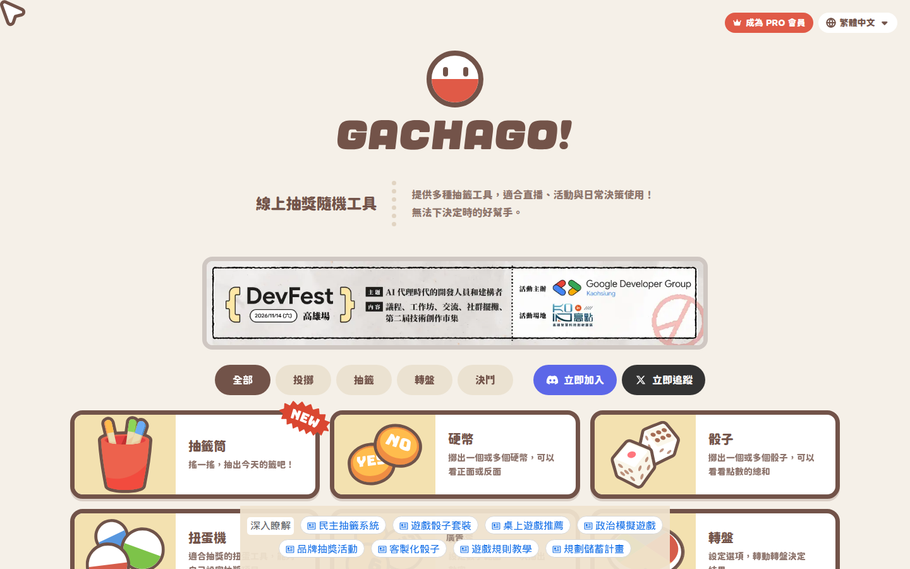
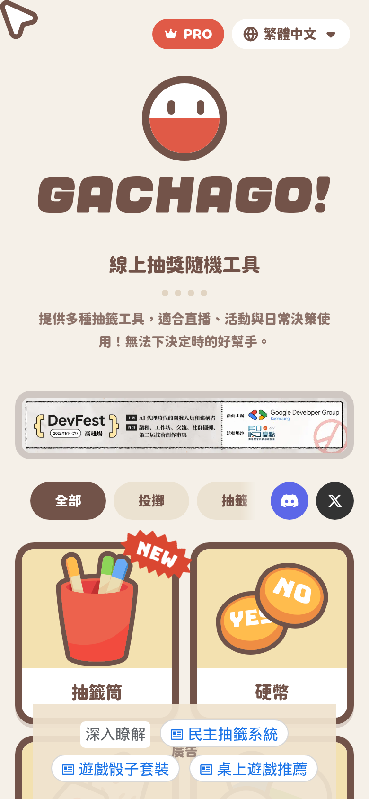
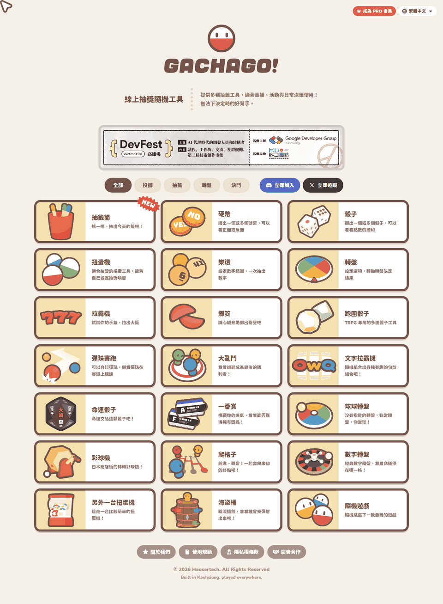

# GACHAGO! 視覺風格分析（學習用）

> 對象：<https://www.gachago.net/>（觀察日期：2026-10-17，實際落地頁為 `/zh-tw`）
>
> 目的：**只學習視覺風格**（配色、字體、版面、元件、動態）。本資料夾不含對方的 Logo 檔、插圖檔或文案；截圖僅作為研究參考，請勿直接用在產品中。

## 這份報告怎麼讀

每個結論都會標示來源可信度：

| 標記      | 意思                                                                      |
| --------- | ------------------------------------------------------------------------- |
| ✅ 已驗證 | 直接來自工具的實際輸出：REA 擷取結果、網站公開 CSS 原文、或截圖像素取樣。 |
| 🔶 推論   | 根據已驗證的資料推理出來，合理但沒有直接證據（例如「這可能是為了……」）。  |
| ❔ 未知   | 這次沒有觀察到或無法確認。                                                |

相關檔案：

- [`tokens.json`](tokens.json)：可重複使用的設計 token（每組都寫了 `$source`）。
- [`tokens.css`](tokens.css)：同一組 token 的 CSS 變數版本，附上卡片、膠囊按鈕、格線、進場動畫的範例 class（自己寫的通用樣式，不是複製對方程式碼）。
- [`screenshots/`](screenshots/)：REA 擷取的截圖。

## 截圖

| 桌機 1440×900                                 | 手機 390×844（2x）                             |
| --------------------------------------------- | ---------------------------------------------- |
|  |  |

整頁（以 1440×3600 viewport 擷取後裁切、縮成 960px 寬）：

> 截圖底部的淺藍色膠囊連結列與「廣告」字樣是 Google AdSense 廣告區，不屬於網站本身的設計。

## 一句話總結風格

**「奶油底 + 咖啡色粗框 + 貼紙感硬陰影 + 圓滾滾的超粗中文字」**——像桌遊卡或扭蛋貼紙的可愛手作風。顏色少、線條粗、沒有模糊陰影，整體非常扁平但有「可以按下去」的立體感。

## 1. 色彩（Color palette）

全部 ✅ 已驗證：來自網站 CSS 的自訂屬性 `--color-ga-*` 與 Tailwind 任意值；主要顏色另外用截圖像素取樣交叉確認（標 📷）。

### 品牌色

| 色票   | Hex       | 用途                                  |
| ------ | --------- | ------------------------------------- |
| 咖啡   | `#725349` | 主要文字、卡片粗框、選中的篩選膠囊 📷 |
| 深咖啡 | `#5e443b` | 品牌色元素的 hover                    |
| 番茄紅 | `#e05a47` | 主色／強調色（PRO 按鈕、吉祥物）📷    |
| 黃     | `#f2c94c` | 插圖點綴                              |
| 橘     | `#f6b340` | 插圖點綴                              |
| 綠     | `#5fb376` | 插圖點綴                              |
| 藍     | `#4d9bea` | 插圖點綴                              |

### 底色與文字

| 色票           | Hex       | 用途                         |
| -------------- | --------- | ---------------------------- |
| 奶油           | `#f5f0e8` | 頁面背景 📷                  |
| 奶油（工具頁） | `#f6f3eb` | 遊戲／工具容器背景           |
| 白             | `#ffffff` | 卡片文字區 📷                |
| 奶黃           | `#f3e1b0` | 卡片插圖區、Logo 下方陰影 📷 |
| 米灰           | `#ebe2d1` | 未選中的篩選膠囊 📷          |
| 米灰 hover     | `#dfd4c3` | 膠囊 hover                   |
| 點狀分隔線     | `#e1d4c2` | 標語旁的粗點線               |
| 灰褐           | `#9a867b` | 次要提示文字                 |

### 透明度用法

- 次要文字是咖啡色 80% 不透明（`text-brand/80`）。✅
- 頁尾膠囊是咖啡色 60%，疊在奶油底上實際呈現 `#a69289`。✅📷
- 社群按鈕使用各平台色：Discord `#5c67e8`（📷 驗證）、X `#333333`。✅

🔶 推論：整體是「暖色低彩度底 + 一個高彩度紅色重點」，四個插圖色（黃橘綠藍）只出現在插圖，不用在 UI 元件上，所以畫面雖然可愛但不雜亂。

## 2. 字體（Typography）

| 項目       | 內容                                                                    | 可信度                                                             |
| ---------- | ----------------------------------------------------------------------- | ------------------------------------------------------------------ |
| 主要字體   | **Chiron GoRound TC**（Google Fonts，圓體，可變字重 200–900）           | ✅ CSS `*{font-family:Chiron GoRound TC}` 與 Google Fonts 網路請求 |
| 字重       | **全站預設 900**（最粗）。CSS 在 `*` 選擇器上直接設定 `font-weight:900` | ✅                                                                 |
| 英文展示字 | Bungee（有 `.!font-bungee` 工具 class）                                 | ✅ 已載入；❔ 實際用在哪個畫面未確認                               |
| Logo 字    | 是 SVG 圖檔，不是網頁字體                                               | ✅ 請求 `logo-text-en.svg`                                         |
| 圖示       | Font Awesome 7（inline SVG，例如 discord、x-twitter、star）             | ✅ CSS 變數與 class 名稱                                           |

字級（Tailwind v4 預設級距，✅ 由 HTML class 驗證用法）：

| 元素              | 手機                         | ≥768px／≥800px                |
| ----------------- | ---------------------------- | ----------------------------- |
| 標語（hero 左側） | 20px（`text-xl`），行高 28px | 24px（`text-2xl`），行高 36px |
| 標語說明          | 14px，行高 24px              | 16px，行高 28px               |
| 篩選膠囊          | 14px                         | 16px                          |
| 卡片標題          | 18px                         | 20px                          |
| 卡片說明          | 隱藏                         | 14px，行高 1.6，80% 不透明    |
| 區塊大標          | `clamp(32px, 5vw, 36px)`     | 同左                          |

🔶 推論：全站用最粗的圓體，是這個風格最關鍵的一點。如果你換成一般 400／700 字重，可愛感會大幅下降。

## 3. 間距、格線與版面

✅ 已驗證（CSS 與 HTML class）：

- **間距單位**：`--spacing: .25rem`（4px 為基準的 Tailwind 刻度）。
- **內容寬度**：主容器 `max-width: 1250px`、左右 `padding: 16px`；標語區 `max-width: 800px`。
- **頁面骨架**：`body` 高度鎖在 `100vh` 且 `overflow:hidden`，真正捲動的是內層 `overflow-y:auto` 容器（並隱藏系統捲軸）。🔶 推論：這樣做方便固定廣告列與自訂游標。
- **卡片格線**：
  - 手機：`repeat(auto-fit, minmax(min(100%,160px), 1fr))`，gap 12px → 390px 寬時兩欄。
  - ≥800px：固定兩欄，gap 16px。
  - ≥1180px：三欄。
- **斷點**：640、768、800、1024、1180px（後兩個是自訂值）。
- **Hero**：Logo 群組置中（Logo 圖 90×90，文字 Logo 高 40px → 48px），下方「標語｜粗點線｜說明」在手機垂直堆疊、桌機水平排列。
- **右上角**：`absolute top-5 right-5` 放 PRO 按鈕與語言選單。
- **底部**：`fixed` 置中的廣告容器（320×100 → 728×90），內容底部留 `pb-30`（120px）避免被遮住。

## 4. 元件

### 導覽／篩選列（Nav）

- 沒有傳統頂部導覽列；主要導覽是**水平可捲動的篩選膠囊列**（隱藏捲軸）。✅
- 膠囊：`border-radius: 9999px`、高 40px → 48px、最小寬 80px、`font-bold`。✅
  - 選中：咖啡底 + 白字。
  - 未選中：`#ebe2d1` 底 + 咖啡字，hover 變 `#dfd4c3`。
  - `transition-colors`（150ms）。
- 同一列右側接 Discord（`#5c67e8`）與 X（`#333`）圓角按鈕；手機只顯示圖示，≥768px 才顯示文字。✅
- 右上：紅色 PRO 膠囊按鈕、白底地球圖示語言選單。✅📷（🔶 此區由前端渲染，HTML 原始碼中沒有，class 細節未確認）

### 按鈕

- 一律膠囊形（全圓角），無邊框、無陰影，靠底色區分層級。✅
- 頁尾連結也是膠囊：咖啡 60% 底 + 白字 + 左側圖示，hover 變深咖啡。✅

### 卡片（核心元件）

✅ 已驗證（HTML class + 截圖）：

- 白底、**7px 咖啡色實線粗框**、圓角 20px、`overflow:hidden`。
- **硬陰影**：`box-shadow: 0 4px 0 #72534935`（沒有模糊，像貼紙底下的厚度）。
- 手機：直式，`aspect-ratio: 9/10`，上半部奶黃插圖區、下半部標題。
- ≥800px：橫式，高 140px，左側 160px 插圖區、右側標題 + 說明。
- 「NEW」標籤：絕對定位在右上角外側（`-top-6 -right-3`），旋轉 12°，蓋在卡片邊框上。
- 插圖風格：粗咖啡描邊、平塗色、少量高光（📷 觀察；🔶 推論為與 UI 同一套描邊語言）。

### Hero／Logo

- 圓形吉祥物：白底、8px 咖啡框、下半紅色、兩個眼睛，下方有奶黃橢圓陰影。✅ CSS module `logo-module__*`
- 標語與說明之間是 7px 粗點線分隔（手機為水平、桌機為垂直）。✅

### 頁尾（Footer）

- 沒有 `<footer>` 元素，是置中的一般區塊。✅
- 內容：一排膠囊連結 + 版權文字 + 一行英文副標，文字是咖啡色 60% 不透明、小字。✅📷

## 5. 動畫與互動

| 互動       | 內容                                                                                                  | 可信度                                                 |
| ---------- | ----------------------------------------------------------------------------------------------------- | ------------------------------------------------------ |
| 卡片 hover | 300ms 內陰影從 `0 4px 0` 變 `0 0 0`，同時 `translateY(4px)` → 像「被按下去」                          | ✅ HTML class；只在 `@media (hover:hover)` 生效        |
| 膠囊 hover | 150ms 顏色漸變                                                                                        | ✅                                                     |
| 區塊進場   | `riseFade`：400ms `ease-out`，從 `translateY(20px)`、透明度 0 升起；有 `animation-delay:300ms` 的錯開 | ✅ CSS module `home-module__*`                         |
| 減少動態   | `prefers-reduced-motion: reduce` 時關閉進場動畫                                                       | ✅                                                     |
| 自訂游標   | 在 `pointer:fine`（滑鼠）裝置上隱藏系統游標（`cursor:none`），改用 `cursor.svg` 箭頭跟隨              | ✅ CSS + 網路請求 `/svg/cursor.svg`；截圖左上角可見    |
| 卡片點擊   | 卡片元素上有直接註冊的 `click` 監聽器                                                                 | ✅ REA `inspect-web-event-listeners`（`ev_dcc0240d…`） |
| 其他       | Tailwind 的 `animate-pulse`、`animate-bounce`、Font Awesome 動畫 class 存在於 CSS                     | ✅ 存在；❔ 首頁是否實際使用未確認                     |

🔶 推論：「硬陰影 + 按下位移」是整個風格的互動招牌，成本低、效果強，非常值得學。

## 6. 前端框架與函式庫

| 技術                                                             | 證據                                                                                                  | 可信度                               |
| ---------------------------------------------------------------- | ----------------------------------------------------------------------------------------------------- | ------------------------------------ |
| **Next.js（App Router）**                                        | REA `analyze-web-bundle` 指紋（high）；`/_next/static/chunks/`、HTML 中的 `self.__next_f`（RSC 串流） | ✅                                   |
| **React**                                                        | REA 指紋（medium）                                                                                    | ✅                                   |
| **Turbopack** 打包                                               | chunk 檔名 `turbopack-*.js`                                                                           | ✅ 檔名；🔶 推論為 Turbopack 建置    |
| **Tailwind CSS v4**                                              | `--tw-*` 屬性、`--spacing` 單一刻度、`--text-*--line-height` 命名、`lab()` 色彩 fallback              | ✅ CSS 結構；🔶 版本號由命名慣例推論 |
| tw-animate-css（或同類）                                         | `--tw-enter-*`／`--tw-exit-*` 變數與 `@keyframes enter`                                               | 🔶 推論                              |
| CSS Modules                                                      | `logo-module__IGneoq__*`、`home-module__oe3DtG__*`                                                    | ✅                                   |
| Font Awesome 7                                                   | `--fa-*` 變數、`svg-inline--fa` class                                                                 | ✅                                   |
| Google Fonts                                                     | Chiron GoRound TC、Bungee                                                                             | ✅ 網路請求                          |
| Firebase Remote Config                                           | `firebaseremoteconfig.googleapis.com` 請求                                                            | ✅                                   |
| Google Analytics 4、AdSense、Cloudflare Web Analytics、reCAPTCHA | 對應網域的網路請求                                                                                    | ✅                                   |
| 多語系                                                           | 首頁導向 `/zh-tw`、`/en` 等語系路徑                                                                   | ✅ URL；❔ 使用哪個 i18n 套件未知    |

## 7. 如何套用到自己的專案（給初學者）

1. 引入字體（Google Fonts）：`Chiron GoRound TC`，並在根元素設定 `font-weight: 900`。
2. 複製 [`tokens.css`](tokens.css) 到專案，把頁面根元素加上 `class="gg-page"`。
3. 卡片用 `.gg-card` + `.gg-card__media`，格線用 `.gg-grid`，按鈕用 `.gg-pill`。
4. 如果用 Tailwind v4，可把 `tokens.json` 的 `color` 轉成 `@theme { --color-*: … }`。
5. 換成**你自己的**品牌主色與插圖；保留「粗框、硬陰影、奶油底、超粗圓體」這四個結構特徵即可得到相似氛圍。

## 驗證方式與證據

使用此 repo 的 REA CLI（`npx -y rea-agents@latest`，版本 6.5.0，Node 22.23.3；套件 engines 支援 `^22.19.0 || ^24.11.0`）。只用 CLI，所以沒有執行 `rea setup`（它是用來把 MCP 伺服器註冊進代理程式設定，這次不需要）。

| 步驟                                  | REA 指令                      | Evidence ID                                                           |
| ------------------------------------- | ----------------------------- | --------------------------------------------------------------------- |
| 桌機截圖 + DOM + 網路事件（1440×900） | `capture-browser-scenario`    | `ev_936dbfa348169eb195e5c9deb3dbeb4b996da9cd82c60407dd8590f3e7be790a` |
| 手機截圖（390×844、DPR 2）            | `capture-browser-scenario`    | `ev_eb74903d18099f9a28f243b6f94036ebf1e7c5e6bd52b4d5986b9d8ce8d5d0f4` |
| 整頁截圖（1440×3600）                 | `capture-browser-scenario`    | `ev_59bb00579e43ff5480303dc87cb55806890bdcf23b61c24e5cace08ee0bd1eed` |
| 頁面結構、腳本、資源                  | `inspect-web-page`            | `ev_0eedaa91ab283227e67a264378518e53deb21a2bd4c4da73cb748629e85bb82d` |
| 框架指紋（31 個腳本、0 解析失敗）     | `analyze-web-bundle`          | `ev_6387ff24cfd46848c1b9ed63989786007cf04ae14f4fbe3d81c83f98ddce03d8` |
| 卡片事件監聽器                        | `inspect-web-event-listeners` | `ev_dcc0240d7d7c24e398de7a9ecdba288702b96cccd71225800416152c347338c3` |

截圖 SHA-256（REA 產出的內容位址，與本資料夾檔案一致）：桌機 `f373c095…aebc`、手機 `1be44ce7…f34e`。整頁圖是從 `74861212…d459` 裁切縮小而來。

情境設定：`locale: zh-TW`、`timezone: Asia/Taipei`、`reduced_motion: no-preference`、等待 4 秒後擷取。

### REA 的限制，以及我們如何補足

- REA 的 DOM 擷取**刻意不保留屬性值與文字**（資料最小化設計），所以無法直接從 REA 得到 class 名稱或顏色。色票、字體、版面數值改由**一次性下載**首頁 HTML 與 2 個公開 CSS 檔（`/_next/static/chunks/*.css`）解析，屬於 ✅ 原文驗證，但不是 REA 輸出。
- REA 截圖只擷取可見 viewport，沒有捲動動作，因此整頁圖是用加高的 viewport 取得。
- REA 情境沒有 hover 動作，所有 hover 效果都來自 CSS 原文，**未在瀏覽器中實際觸發**。
- 網路／主控台觀察只涵蓋 REA 附加之後的時間窗。

### 存取禮節

- `robots.txt` 為 `User-agent: * Allow: /`，已確認允許。
- 總共只有一般頁面造訪：3 次 REA 情境載入（每次自帶臨時瀏覽器設定檔，結束後刪除）、1 個本機無頭 Chrome 分頁供 CDP 檢查，以及 HTML + 2 個 CSS 的單次下載（每次請求間隔 2 秒）。沒有點擊、登入、表單送出或爬取其他頁面。

## 未確認事項

- ❔ 各工具（遊戲）內頁的風格：只分析了首頁。
- ❔ 深色模式：CSS 中未見對應規則，情境也只用 light 模式擷取。
- ❔ Bungee 字體與 `pulse`／`bounce` 動畫在首頁的實際使用位置。
- ❔ 右上角 PRO／語言選單的精確 class（前端渲染，未出現在原始 HTML）。
